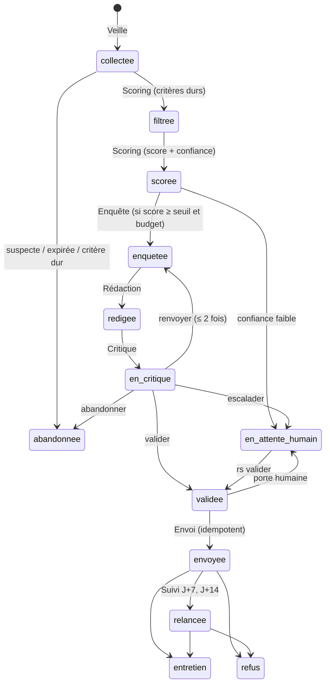

# Recherche de stage — système multi-agents

Automatise la recherche, la candidature et le suivi d'un stage, de la
définition du profil jusqu'à l'entretien. Huit agents spécialisés, un
orchestrateur et un agent d'apprentissage se passent un **dossier de
candidature** commun ; chaque décision est journalisée avec le hash de ses
entrées pour pouvoir être rejouée.

Au départ, rien ne part sans validation humaine. La porte se lève toute seule
pour les candidatures standard une fois que 95 % des 30 derniers dossiers ont
été validés sans retouche.

## Pipeline



| Spécification | Code |
|---|---|
| Schéma `dossier_candidature` | `src/recherche_stage/modeles.py` |
| Orchestrateur | `orchestrateur.py` |
| 1 Profil | `agents/profil.py` |
| 2 Veille | `agents/veille.py`, `sources/` |
| 3 Scoring | `agents/scoring.py` |
| 4 Enquête entreprise | `agents/enquete.py` |
| 5 Rédaction | `agents/redaction.py` |
| 6 Critique | `agents/critique.py` (couches 2 à 4), `controles.py` (couche 1) |
| 7 Envoi | `agents/envoi.py`, `canaux/messagerie.py`, `canaux/pdf_simple.py` |
| 8 Suivi | `agents/suivi.py`, `canaux/agenda.py` |
| Apprentissage | `agents/apprentissage.py` |
| Mode d'autonomie | `autonomie.py` |
| Retries, disjoncteur | `resilience.py` |
| Journal, idempotence, budget | `store.py` (SQLite) |
| Accès au LLM | `llm.py` (Claude), `llm_gemini.py` (Gemini, routeur) |

## Installation

Python 3.11 ou plus.

```powershell
cd recherche-stage
python -m venv .venv
.venv\Scripts\Activate.ps1          # Linux / macOS : source .venv/bin/activate
pip install -e ".[pdf,gemini,dev]"
$env:ANTHROPIC_API_KEY = "sk-ant-..." # Claude (ou : ant auth login)
$env:GEMINI_API_KEY = "..."           # Gemini, clé sur aistudio.google.com
$env:IMAP_MOT_DE_PASSE = "..."        # lecture des réponses et des alertes (Gmail : mot de passe d'application)
```

### Choix du modèle : Claude, Gemini ou les deux

Dans `config.yaml`, section `llm` :

| Réglage | Effet |
|---|---|
| `fournisseur: claude` | tous les agents sur Claude (défaut) |
| `fournisseur: gemini` | tous les agents sur Gemini (`gemini_modele`) |
| `fournisseur: claude` + `fournisseur_critique: gemini` | rédaction par Claude, relecture par Gemini (ou l'inverse) : le Critique ne partage ni le modèle ni les biais du rédacteur |

Avec Gemini (`gemini-3.8-flash` par défaut), l'Enquête s'appuie sur
l'ancrage Google Search. La température du Critique (`temperature_critique`,
0,1) n'est appliquée qu'aux modèles Gemini 1.x et 2.x : Google déconseille de
l'abaisser à partir de Gemini 3. Le niveau de réflexion des Gemini 3+ est
réglé par `gemini_reflexion` (`low`) et `gemini_reflexion_critique` (`medium`) :
le défaut de Google (`high`) rend chaque appel nettement plus lent. Un modèle
saturé (503/429) est remplacé par le suivant de `gemini_modele_secours`, et
n'est plus réessayé jusqu'à la fin de la commande. `rs cycle` affiche son
avancement étape par étape.

## Démarrage

```powershell
rs init                                   # crée config.yaml, preferences.yaml, imports/
# compléter preferences.yaml (dates, zone, critères) et config.yaml (SMTP, IMAP, sources)
rs profil --cv cv.pdf --releves releve_S1.pdf releve_S2.pdf
rs cycle                                  # veille → scoring → enquête → rédaction → critique → brouillon
rs file                                   # ce qui attend une décision
rs voir <id>                              # documents, note du Critique, problèmes relevés
rs valider <id>                           # ou : éditer mail_vN.txt / lettre_vN.txt, puis rs valider <id> --modifie
rs cycle                                  # envoie les dossiers validés, lit la boîte, relance
```

Autres commandes : `rs rejeter`, `rs reponse <id> entretien --date 2026-11-03T14:00`,
`rs marquer-envoye`, `rs liberer-envoi`, `rs statut`, `rs journal [<id>]`,
`rs rejouer <id> --complet`, `rs bilan [--appliquer]`, `rs rgpd export|purger`,
`rs detecter-ats <url>`.

Pour un fonctionnement autonome, planifier `rs cycle` deux fois par jour
(Planificateur de tâches Windows, ou `cron`). Le système ne collecte une
source qu'une fois toutes les 12 h et n'envoie qu'en matinée, du lundi au
jeudi (réglable).

## Sources et CGU

Aucun scraping de plateforme dont les conditions l'interdisent. Tout se règle
dans la section `sources` de `config.yaml`.

| Source | Accès | À faire |
|---|---|---|
| **Sites carrière** | API publiques des ATS : Greenhouse, Lever, SmartRecruiters, Workable, Ashby, Recruitee, Personio | Ajouter l'entreprise sous `ats:` avec l'adresse de sa page d'offres. `rs detecter-ats <url>` trouve l'ATS à partir de la page carrière de l'entreprise |
| **Indeed, JobTeaser**, Welcome to the Jungle, HelloWork, APEC | Lecture de **tes alertes mail** dans ta boîte (IMAP) | Créer une alerte « stage » sur chaque site, renseigner `suivi.imap`, puis `alertes_mail: true` |
| Flux RSS/Atom | Flux publiés par un site carrière ou un site d'offres | Ajouter l'adresse sous `flux:` |
| Adzuna (agrégateur) | API officielle, gratuite | Clés sur developer.adzuna.com, puis `adzuna: true` |
| France Travail | API officielle « Offres d'emploi v2 » | Compte francetravail.io, puis `france_travail: true` |
| Annuaire (candidatures spontanées) | API publique recherche-entreprises.api.gouv.fr, filtrée par codes NAF, départements et effectif ; l'établissement retenu est celui du département (agence locale d'un groupe) | `annuaire: true`, puis `annuaire_codes_naf`, `annuaire_departements`. Chaque cycle reprend la liste là où le précédent s'est arrêté |
| Export manuel | CSV ou JSON déposé dans `imports/`, nommé `<source>_….csv` | Exemple : `src/recherche_stage/exemples/offres.exemple.csv` |
| LinkedIn | Exclu | |

**Alertes mail.** Le LLM repère les offres dans chaque mail d'alerte, puis
le code ne garde une offre que si son intitulé et son entreprise sont écrits
dans le mail et que son lien y figure. Chaque mail n'est lu qu'une fois, et le
Suivi ne le prend pas pour une réponse d'entreprise. Si tu ranges les alertes
sous un libellé Gmail, indique-le dans `alertes_dossier`.

**Sites carrière sans API.** Workday, Taleo, SuccessFactors, Teamtailor et
iCIMS n'ont pas d'API publique documentée : `rs detecter-ats` le signale.
Pour ces entreprises, crée une alerte mail sur leur site carrière ou utilise
leur flux RSS s'il existe.

**Candidature.** Le système envoie lui-même les candidatures par mail. Les
formulaires des sites carrière et des plateformes ne sont jamais remplis
automatiquement : il prépare le CV, la lettre et les réponses dans
`a_deposer.md`, tu déposes, puis tu lances `rs marquer-envoye`.

Une source qui échoue est retentée (2 s, 8 s, 30 s), son quota passe à la
source suivante, et après 3 échecs consécutifs le disjoncteur la coupe 24 h et
prévient l'humain.

## Ce qui garantit la qualité

- **Aucune information inventée.** Le rédacteur doit déclarer, pour chaque
  phrase factuelle, les éléments du profil (`exp1`, `comp_gmao`…) ou de la
  fiche entreprise (`fiche:0`) qui la fondent. Le Critique vérifie que ces
  références existent (contrôle déterministe), puis qu'elles justifient bien
  la phrase (LLM). L'Enquête écarte tout fait dont l'URL ne fait pas partie
  des pages réellement consultées.
- **Critique indépendant.** Prompt distinct, modèle configurable à part,
  questions fermées par critère. La note n'est pas demandée au modèle : elle
  est calculée à partir des réponses selon la grille (exactitude 35 %,
  contrôles déterministes 20 %, adéquation 25 %, spécificité 10 %, forme 10 %).
  ≥ 80 sans point bloquant : validé ; 60–80 ou bloquant corrigible : renvoyé
  (2 fois au plus) ; sinon, question précise à l'humain.
- **Contrôles déterministes.** Nom exact de l'entreprise, nom d'une *autre*
  entreprise candidatée, intitulé, champs à compléter, dates futures hors
  disponibilité, longueur, coordonnées, pièces jointes, formules creuses, et
  règles apprises.
- **Jamais deux candidatures au même poste.** Clé unique entreprise +
  intitulé normalisés ; chaque envoi est réservé en base avant transmission,
  et la réservation survit à la purge RGPD.

## Apprentissage

Chaque semaine, `bilans/bilan_AAAA-SNN.md` résume les résultats et produit
des propositions :

- **allocation des sources** par bandit (Thompson, 10 % d'exploration),
  appliquée d'office ;
- **A/B des lettres** : angle d'accroche × format (lettre ou mail seul),
  attribué par Thompson à chaque nouveau dossier ;
- **recalibrage du scoring** (poids des critères et des composantes selon le
  taux d'entretien), **calibration du Critique** (faux négatifs : validé puis
  retouché par l'humain ; faux positifs : escaladé puis validé tel quel),
  **nouvelles règles** (erreur vue dans 3 dossiers → contrôle déterministe) :
  appliqués par `rs bilan --appliquer`.

## RGPD

- Tout reste en local : base SQLite et fichiers sous `donnees/` (exclus de git).
- Données transmises à des tiers : le profil et l'offre à l'API du
  fournisseur choisi (Anthropic ou Google) pour chaque étape LLM, ainsi que
  le texte des mails d'alerte d'offres ; les
  candidatures au destinataire choisi. Retirer du CV ce qui n'est pas utile
  (date de naissance, adresse complète, photo).
- Sur l'offre gratuite de l'API Gemini, Google peut utiliser les contenus pour
  améliorer ses produits : préférer une clé liée à un compte de facturation.
- L'annuaire ne conserve que des données d'entreprise, jamais les dirigeants.
- `rs rgpd export` exporte tout ; `rs rgpd purger` supprime les dossiers
  terminés depuis plus de `conservation_mois` (12 par défaut).
- Le correcteur LanguageTool, optionnel, doit tourner en local.

## Écarts assumés par rapport à la spécification

- **Température 0,1 du Critique** : appliquée seulement quand le Critique
  tourne sur Gemini 1.x ou 2.x. Les modèles Claude actuels n'acceptent plus
  de paramètre d'échantillonnage et Google déconseille de l'abaisser à partir
  de Gemini 3 : la stabilité vient alors des questions fermées et du calcul
  déterministe de la note.
- **CV adapté** : produit en HTML imprimable (`cv_vN.html`). Le PDF d'origine
  est joint, sauf si un export `cv_vN.pdf` existe dans le dossier. La lettre,
  elle, est convertie en PDF automatiquement.
- **Formulaires et plateformes** : jamais soumis automatiquement. Le système
  prépare pièces et réponses (`a_deposer.md`) ; l'humain dépose puis lance
  `rs marquer-envoye`.
- **Fallbacks** : les appels LLM activent le repli côté serveur
  (`fallbacks: "default"`) si le modèle décline une requête.

## Tests

```powershell
pytest
```

Aucun test n'appelle le réseau ni le LLM : faux LLM, fausses sources, faux
SMTP/IMAP ; `test_llm.py` et `test_llm_gemini.py` vérifient les requêtes
réellement produites par les SDK Anthropic et google-genai contre un serveur
local.
